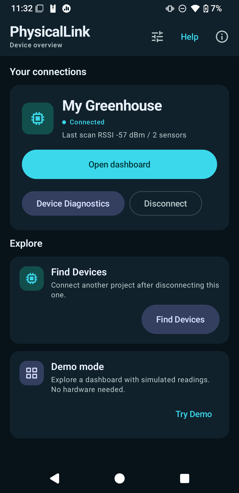
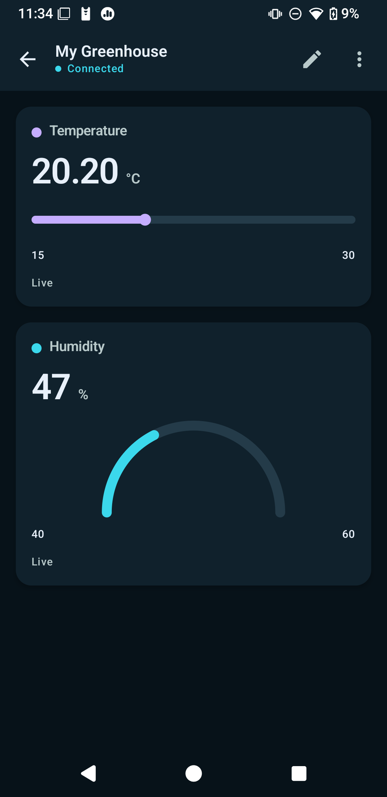

# PhysicalLink

**Turn ESP32 sensor readings into a customizable Android dashboard—without building a separate mobile UI for every project.**

PhysicalLink is a local-first, sensor-agnostic project combining a reusable **ESP32 C++ firmware library** with a **Kotlin / Jetpack Compose Android app**. Makers register numeric sensors in firmware; the app discovers their capabilities over Bluetooth Low Energy (BLE) and automatically generates a dashboard.

> **Project status:** Engineering portfolio / demonstration project. PhysicalLink previously reached a Google Play **internal testing** release and a PlatformIO library release. Store/registry withdrawal was requested, but successful removal has not been verified here. Do not assume public installation links are currently available. The Android source is maintained separately and is not linked publicly in this README.

## Screenshots

| Device overview | Greenhouse dashboard |
| --- | --- |
|  |  |

## What it does

- **Discovers ESP32 sensors automatically.** Firmware advertises each sensor's stable ID, display name, unit, and numeric readings.
- **Connects directly over BLE.** No account or developer-operated cloud backend is needed for the implemented sensor-monitoring workflow.
- **Builds customizable dashboards.** Choose **Value**, **Chart**, **Gauge**, or **Range** widgets; reorder, resize, duplicate, hide, and configure them independently.
- **Provides visualization-specific details.** Tap a widget to explore its corresponding detail view and adjust settings inline, including chart time windows and optional axis bounds.
- **Shows data honestly.** Distinguishes current, last-known, stale, unavailable, and disconnected measurements.
- **Includes Demo Mode.** Explore the app and its visualizations without an ESP32.
- **Remembers preferences.** Dashboard layouts, widget configurations, and appearance preferences are stored locally.

## How it works

```text
ESP32 + sensors
     │
     │  PhysicalLink C++ library
     │  Registers sensors and publishes numeric readings
     ▼
BLE GATT service (PhysicalLink protocol v2)
     │
     ├── Paged JSON metadata: device and sensor capabilities
     └── Binary numeric measurements and availability state
     │
     ▼
Android BLE client
     │  Discovers metadata, processes readings, tracks freshness
     ▼
Jetpack Compose application
     ├── Device Overview and Demo Mode
     ├── Auto-generated dashboard
     ├── Value / Chart / Gauge / Range widgets
     └── Visualization-specific Sensor Details
```

The firmware and Android application are independent projects sharing a documented BLE contract and corresponding test fixtures. The current design supports **one active BLE device connection at a time**.

## Technology

| Layer | Technology |
| --- | --- |
| Firmware | ESP32, C++, Arduino framework, PlatformIO |
| BLE transport | NimBLE-Arduino, custom GATT protocol v2 |
| Android | Kotlin, Jetpack Compose, Material 3 |
| App architecture | ViewModel, coroutines/Flow, Navigation, Hilt |
| Local preferences | Android DataStore |
| Tests | JVM/Robolectric tests, C++ native tests, protocol fixtures |

## Repositories and documentation

- **Firmware and examples:** [DaCodaHUB/PhysicalLink-firmware](https://github.com/DaCodaHUB/PhysicalLink-firmware)
- **Firmware development instructions:** [DEVELOPMENT.md](https://github.com/DaCodaHUB/PhysicalLink-firmware/blob/main/DEVELOPMENT.md)
- **Developer portfolio:** [DaCodaHUB](https://dacodahub.github.io/)
- **Privacy policy:** [PhysicalLink Privacy Policy](https://dacodahub.github.io/physicallink/privacy/)

The Android repository is currently private; there is no public Android source or installation URL provided here.

## Development and local builds

### Firmware

Clone the public firmware project and follow its [`DEVELOPMENT.md`](https://github.com/DaCodaHUB/PhysicalLink-firmware/blob/main/DEVELOPMENT.md) for toolchain setup, the three PlatformIO environments, native tests, standalone consumer verification, and packaging. The repository includes examples for a minimal project, real BME280/soil readings, and a 16-channel synthetic stress test.

### Android

The separately maintained Android project is built with Android Studio and Gradle. From that project root, its reported validation command is:

```powershell
.\gradlew.bat test lint build
```

To use live hardware, flash compatible PhysicalLink firmware to an ESP32 and connect from the Android app's **Find Devices** flow. **Try Demo** works without a board. This README does not offer a public APK or Play Store link while distribution status is unresolved.

## Engineering highlights

### Metadata-driven UI

The Android app does not hardcode temperature, moisture, or any other sensor category. It interprets device-supplied sensor IDs, labels, and units and renders suitable numeric widgets. Two widgets can display the same sensor with different settings.

### BLE protocol and lifecycle

The custom protocol handles capability metadata that may require multiple BLE pages, binary numeric streaming, explicit unavailable states, and stable device identity. Android manages asynchronous GATT operations and separates current data from retained last-known readings.

### Configurable visualizations

Widgets offer independently persisted settings. Sensor Details provides inline draft/preview/apply behavior; invalid numeric bounds cannot be saved, and canceled changes do not overwrite a valid configuration.

### Independent validation

The most recent **reported** project validation included:

- **266 Android automated tests passing**, with zero lint errors at that stage.
- **45 native firmware tests passing**.
- Successful builds of the firmware's **basic**, **real-sensors**, and **stress-test** PlatformIO environments.
- Standalone firmware-library consumer and package-verification checks.
- A signed Android App Bundle verified and distributed on the **Google Play internal testing track**.

These are historical development results, not a claim of current store availability or comprehensive hardware reliability certification.

## Boundaries and future ideas

The implemented version is a **live visualization and prototyping tool**, not a guaranteed unattended monitoring system. Its history is bounded and held in memory; it is **not** a persistent time-series database. Direct BLE requires the phone to be in range, and the app does not provide reliable remote alerts or device actuator commands.

Ideas explored for future development—but **not implemented** in the documented release—include threshold notifications, dependable background monitoring, persistent local history, higher-throughput latest-value streaming, configurable display refresh, sensor calibration, and optional bidirectional output control.

## Author

Developed by **Dang Le**, under the **DaCodaHUB** developer name.

For project background, visit [dacodahub.github.io](https://dacodahub.github.io/).

---

*PhysicalLink is intended for learning, prototyping, and maker projects. Do not rely on it alone for safety-critical monitoring or control.*
